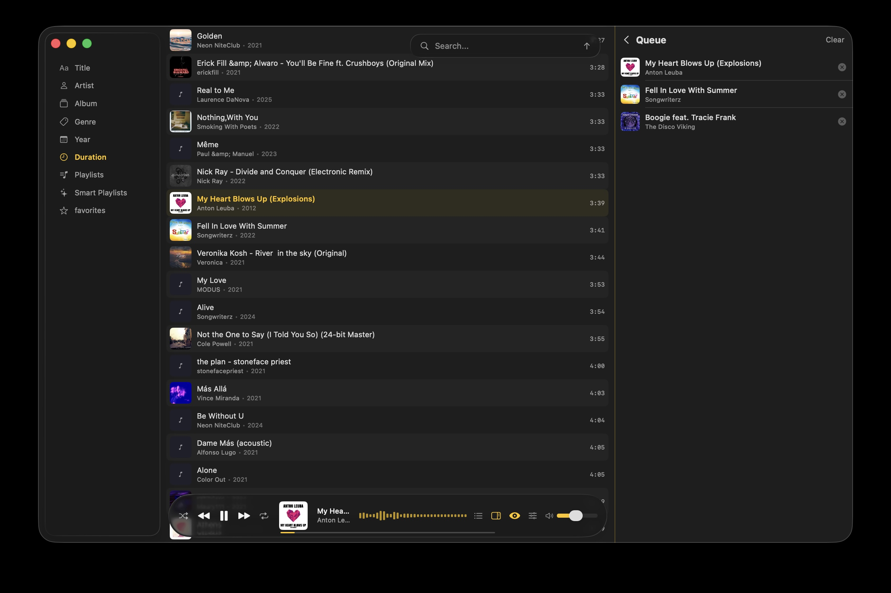
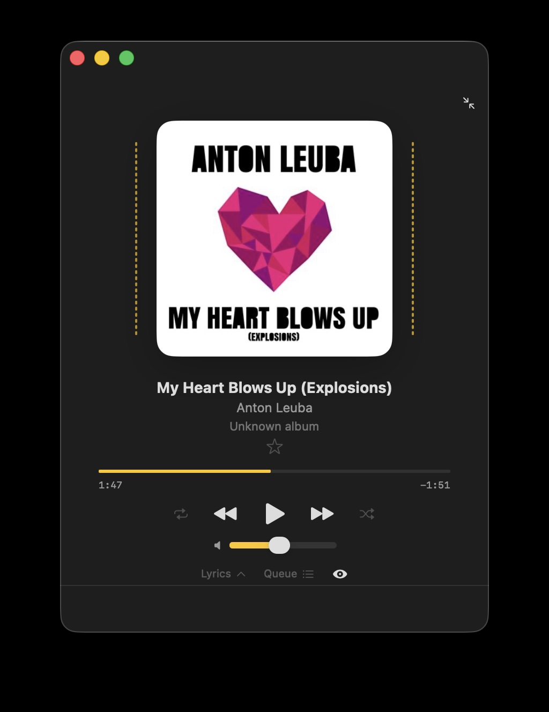

# 🎵 Melodica

> **📌 Installation:** Available via [Homebrew](#option-1--homebrew-recommended) or [direct download](#option-2--direct-download). See [Download](#-download) below.  
> **⏸️ Project Status:** Active feature development is currently on hold as I have implemented everything I had in mind and ran out of new ideas. However, the project is actively maintained — if you encounter any bugs, please open an issue and I'll gladly fix them!

No big words or corporate fluff here.  
This is just a solid, good-looking audio player for macOS that I built for myself, because nothing else on the market felt right.

If you've also been looking for a lightweight player that actually handles tags, volume, and lyrics properly — maybe this one will click with you.

---

**Jump to:**
- [✨ Features](#-features)
- [⌨️ Keyboard Shortcuts](#️-keyboard-shortcuts)
- [🖼️ Screenshots](#️-screenshots)
- [🔧 Requirements](#-requirements)
- [📝 About `-pre` versions](#-about--pre-versions)
- [📦 Download](#-download)
- [🙏 Acknowledgements](#-acknowledgements)
- [📄 License](#-license)

---

## ✨ Features

### 🎧 Playback & Audio Engine
- **Broad Format Support**: Native playback for MP3, FLAC, M4A, ALAC, AAC, OGG, and OPUS.
- **CUE Sheet Support**: Seamlessly parse and play single-file albums split by `.cue` files.
- **Gapless Playback & Crossfade**: Smooth transitions between songs with configurable crossfade duration.
- **Silence Skip**: Automatically trims silence at the end of tracks with a configurable threshold.
- **ReplayGain**: Track and album gain normalization with peak clipping protection so volume never jumps abruptly.
- **Auto Volume Leveling (Night Mode)**: Dynamic range compression and loudness normalization for quiet listening environments.
- **Equalizer**: 10-band equalizer with custom presets and **auto-apply by genre**.
- **Spatial Audio & Sound Effects**: Advanced 3D spatial audio engine with customizable rendering algorithms (HRTF, Spherical, Equal Power, SoundField), virtual stereo speaker spread, 3D listener positioning, occlusion simulation, alongside dedicated Reverb (with room presets) and Delay (time, feedback, low-pass filter) effects.
- **Precise Volume Control**: Smooth volume slider with one-click quick mute and previous volume level restoration.

### 📜 Lyrics & Visualizations
- **Advanced LRC Engine**: Built on Core Animation with smooth **word-by-word karaoke synchronization** and syllabic animations.
- **Comprehensive Tag & Transliteration Support**: Extensive support for phonetic pronunciation scripts, annotations, structural vocal cues, and multi-language lyrics.

<details>
<summary><b>Supported LRC Tags & Pronunciation Guides</b></summary>

| Category | Description | Supported Tags |
|---|---|---|
| **Pronunciation & Transliteration** | Phonetic pronunciation scripts for non-Latin writing systems | `ja-rom` (Romaji), `ja-furi` (Furigana), `ja-hira` (Hiragana), `zh-pinyin` (Pīnyīn), `zh-bpmf` (Bopomofo), `ko-rom` (Romaja), `ru-lat` (Russian Latin), `el-lat` (Greek Latin), `hi-lat` (Hindi Latin), `th-lat` (Thai Latin) |
| **Annotations & Structure** | Structural vocal cues, translations, and musical annotations | `lit` (Literal translation), `note` (Explanatory note), `inst` (Instrumental cue), `bg` (Background vocals), `rap` (Rap verse), `chord` (Chords), `duet-m` (Male duet part), `duet-f` (Female duet part) |
| **Language Tags** | Language identifiers for localized lyric lines (30 languages) | `ja`, `en`, `ko`, `zh`, `zh-hans`, `zh-hant`, `ru`, `uk`, `fr`, `de`, `es`, `it`, `pt`, `nl`, `sv`, `no`, `da`, `fi`, `el`, `pl`, `ar`, `he`, `tr`, `fa`, `hi`, `th`, `vi`, `id`, `ms`, `tl` |
| **File Metadata** | Standard LRC header metadata | `[ti:]` (Title), `[ar:]` (Artist), `[al:]` (Album), `[by:]` (Author / Creator), `[offset:]` (Time offset in +/- ms) |

</details>

- **Interactive Lyrics Translation**: Automatic translation powered by system translation APIs, with language detection and a manual language selection popup fallback.
- **Unsynced & Embedded Lyrics**: Automatic fallback for embedded ID3/USLT and Vorbis comment lyrics.
- **Audio Visualizations**:
  - **Live Spectrum Analyzer**: Real-time FFT frequency spectrum, including dual side-spectrum mode flanking the album cover.
  - **Circular Visualizer**: Pulsing circular frequency wave around album art.
  - **Waveform Progress Bar**: Interactive waveform display with precise live scrubbing.

### 📚 Library & Smart Features
- **Smart Library Management**: Sort tracks by Title, Artist, Album (with track number secondary ordering), Genre, Release Year, Star Rating, or Duration (ascending / descending), search across all metadata fields, and filter favorites or folder visibility.
- **Smart Playlists**: Flexible rule-based dynamic playlists with Match All (AND) and Match Any (OR) modes across 18 criteria.

<details>
<summary><b>Supported Smart Playlist Rules</b></summary>

| Type | Target Field | Conditions |
|---|---|---|
| **Text** | Title, Artist, Album, Genre | `Contains`, `Equals` |
| **Numbers** | Release Year | `Greater than`, `Less than`, `Equals` |
| **Numbers** | Track Duration | `Greater than`, `Less than` |
| **Numbers** | Star Rating | `Greater than`, `Less than`, `Equals` |
| **Flags** | Metadata & Status | `Has Rating`, `Has Lyrics`, `Has ReplayGain`, `Is Favorite` |

</details>

- **Smart Recommendations**: 100% on-device and private algorithmic recommendation engine with zero telemetry. Curates dynamic sections based on your listening habits: time of day, day of week, forgotten gems (tracks unplayed for 30+ / 180+ days), underrated favorites, deep cuts from top artists, and controlled exploration for library discovery.
- **Background Library Enrichment**: Non-blocking multi-phase pipeline (metadata indexing, thumbnail caching, waveform pre-computation) with live progress tracking.
- **Folder Watcher**: Live background folder monitoring automatically syncs new, modified, or deleted tracks without manual re-scans.
- **M3U / M3U8 Playlists**: Full support for importing and exporting playlists.
- **Library Statistics**: Detailed breakdown of your library (total tracks, total media duration, storage size, top artists, favorite genres, and codec distribution).
- **Persistent Playback State**: Restores exact track positions, playback queues, shuffle bags, and volume between app restarts.

### 🏷️ Tag Editing & Audio Quality Analysis

> **Supported Formats:** MP3 (with selectable ID3v2.3 or ID3v2.4 target standards), FLAC (Vorbis comments), M4A / AAC / MP4 (iTunes metadata atoms), OGG, and OPUS.

- **Built-in Tag Editor**: Convenient single-track editor with rapid selection across tracks. Modify Title, Artist, Album, Album Artist, Genre, Release Year, and Track Number.
- **Artwork Management**: View, replace, or remove embedded cover art, convert between JPEG and PNG with custom dimensions and quality, or configure reusable preset artwork for artists and genres.
- **Lossless / Fake FLAC Detective**: Deep spectral and MDCT seam analysis to detect fake lossless files (transcodes upscaled from lossy formats or web streams).
- **Batch Quality Scanner**: Dedicated scan window with real-time queue processing, frequency cutoff analysis, SBR detection, and detailed confidence scores.
- **Rating System**: Read and write 1–5 star ratings directly to audio files (POP-M, Vorbis comments, MP4 tags).

### 🖥️ Interface & Integration
- **Two UI Themes**:
  - **Liquid Glass**: Ultra-modern translucent glass aesthetic designed for macOS.
  - **Default**: Refined dark theme with full accent color customization.
- **Compact Mini Player**: Minimalist floating mini player with lyrics, mini queue, and playback controls.
- **Menu Bar Player**: Control playback, view track info, and adjust volume right from your macOS menu bar.
- **High-Performance AppKit Views**: Virtualized list and grid views capable of scrolling through tens of thousands of tracks at a silky 60/120 fps.
- **Media Keys Support**: Full support for keyboard media keys (F7, F8, F9 / Play, Next, Previous).
- **Multilingual Localization**: Translated into 7 languages — English, Russian (Русский), German (Deutsch), French (Français), Italian (Italiano), Japanese (日本語), and Simplified Chinese (简体中文). Switch anytime in Settings.  
  > *Note: Translations other than Russian and English may contain minor inaccuracies. If you notice any mistakes or awkward phrasings, please feel free to report them via Issues or submit a PR!*
- **Drag & Drop Import**: Supports drag-and-drop of audio files, folders, and playlists (.m3u / .m3u8) directly into the app from Finder.
- **In-App Drag & Drop**: Drag tracks from the library into the playback queue to reorder songs on the fly, or drop new cover images directly onto album art in the Tag Editor.

### 🛠️ Developer & Power-User Tools
- **Developer Diagnostics Suite**: Built-in test window accessible from the menu bar to run self-tests on the audio engine, metadata parsers, playlists, folder watcher, and caches, with exportable reports.
- **Recommendation Simulator**: Interactive tool accessible from the menu bar to preview recommendation algorithms across different times of day and inspect per-track affinity scores.
- **Cache & State Utilities**: Safely reset application state, clear thumbnail/image caches, or rebuild waveform caches on demand.

---

## ⌨️ Keyboard Shortcuts

| Shortcut | Action |
|---|---|
| `Space` | Play / Pause |
| `Cmd` + `Shift` + `→` | Next track |
| `Cmd` + `Shift` + `←` | Previous track |
| `Cmd` + `Shift` + `↑` | Increase volume (+5%) |
| `Cmd` + `Shift` + `↓` | Decrease volume (-5%) |
| `Cmd` + `S` | Toggle shuffle |
| `Cmd` + `R` | Toggle repeat mode (Off / All / One) |
| `Cmd` + `F` | Focus search bar |
| `Esc` | Clear search / dismiss focus |
| `Cmd` + `L` | Toggle lyrics panel |
| `Cmd` + `U` | Toggle playback queue |
| `Cmd` + `Shift` + `M` | Toggle mini player |
| `Cmd` + `,` | Open Settings |

---

## 🖼️ Screenshots

*Screenshots use royalty-free music from [Jamendo](https://www.jamendo.com).*





---

## 🔧 Requirements

- macOS 15.6+ (Sequoia) — minimum
- macOS 26.0+ (Tahoe) — recommended: enables the new Liquid Glass design

---

### 📝 About `-pre` versions

Some releases are tagged `v1.4.3-pre` instead of `v1.4.3`.

**`-pre` doesn't mean "broken" or "unstable"** — it means I tested it enough to be confident it works, but didn't run a full pass through every feature before publishing.

For a personal project like this, waiting for a "complete" test cycle would mean no releases at all. So I ship when it feels right, and fix bugs as they surface.

- ✅ **`-pre`** — works, some edge cases may have slipped through
- ✅ **no suffix** — extra bug sweep before release

Either way, if you find something broken — open an issue.

---

## 📦 Download

### Option 1 — Homebrew (recommended)

The easiest way. Homebrew installs the app and handles the macOS quarantine + ad-hoc signing automatically — no Terminal commands needed after install.

> **Don't have Homebrew yet?**  
> Install it first — it's one command and takes a few minutes:  
> https://brew.sh

To install:

```bash
brew tap yi0027/melodica
brew install --cask yi0027/melodica/melodica
```

To update later:

```bash
brew upgrade --cask yi0027/melodica/melodica
```

To uninstall:

```bash
brew uninstall --cask melodica
brew untap yi0027/melodica
```

### Option 2 — Direct download

Grab the latest `.dmg` from [Releases](https://github.com/Yi0027/Melodica/releases/), open it, and drag `Melodica.app` into your `Applications` folder.

Since I didn't pay Apple for a Developer ID (it's expensive and a pain), macOS will show a warning on first launch: *"Melodica cannot be opened because the developer cannot be verified."* This is expected — the app is ad-hoc signed, just not notarized by Apple.

**To open it:**

1. Try to open `Melodica.app` from your `Applications` folder. You'll see the warning — dismiss it (click **Done** or **Cancel**).
2. Open **System Settings** → **Privacy & Security**.
3. Scroll down to the **Security** section. You'll see a message like *"Melodica.app was blocked from use because it is not from an identified developer."*
4. Click **Open Anyway**.
5. Enter your password if prompted, then click **Open** in the final dialog.

You only need to do this once. After that, the app opens normally with a double-click.

> **Note:** The **Open Anyway** button is only available for about an hour after you try to open the app. If you don't see it, try launching `Melodica.app` again, then go back to System Settings → Privacy & Security.

---

#### If that doesn't work

On some macOS versions, the **Open Anyway** button doesn't appear reliably. In that case, open **Terminal** and run:

```bash
sudo xattr -cr /Applications/Melodica.app
```

This removes the quarantine flag that macOS adds to files downloaded from the internet. After that, the app opens normally.

> **Note:** `xattr` ships with macOS by default — no additional install needed.

---

#### Last resort: re-signing the app

> ⚠️ **You almost certainly don't need this.** Try the steps above first. Re-signing is only useful if the app genuinely refuses to launch *and* `xattr` didn't help.

The app ships with a valid ad-hoc signature, so macOS can verify its integrity. But if something went wrong during download or extraction, you can re-sign it locally:

1. Make sure `codesign` is available on your Mac. It ships with either **Xcode** or **Command Line Tools**. If you've never installed either, open Terminal and run:

```bash
xcode-select --install
```

A system dialog will appear — click Install and wait a few minutes.  
Requires ~2 GB of free disk space. You don't need an Apple ID — just click Install in the dialog.

2. Then re-sign the app:

```bash
codesign --force --sign - /Applications/Melodica.app
```

> **Note:** This overwrites the app's original signature with a fresh ad-hoc one, generated on your machine. It works in most cases, but if the app contains nested frameworks, re-signing can occasionally break them. Prefer the System Settings method whenever possible.

Alternative: if you'd rather not touch Terminal at all, clone the repository in Xcode and hit **Cmd+R**. Xcode will ad-hoc sign the build automatically.

---

## 🙏 Acknowledgements

Special thanks and gratitude to:
- **[FLAC_Detective](https://github.com/Guillain-RDCDE/FLAC_Detective)** by Guillain d'Erceville (Guillain-RDCDE) for the detection algorithms, spectral analysis techniques, and MDCT seam detection logic that power Melodica's Lossless / Fake FLAC Detective.

<details>
<summary><b>FLAC_Detective License (MIT)</b></summary>

```text
MIT License

Copyright (c) 2024 Guillain d'Erceville

Permission is hereby granted, free of charge, to any person obtaining a copy
of this software and associated documentation files (the "Software"), to deal
in the Software without restriction, including without limitation the rights
to use, copy, modify, merge, publish, distribute, sublicense, and/or sell
copies of the Software, and to permit persons to whom the Software is
furnished to do so, subject to the following conditions:

The above copyright notice and this permission notice shall be included in all
copies or substantial portions of the Software.

THE SOFTWARE IS PROVIDED "AS IS", WITHOUT WARRANTY OF ANY KIND, EXPRESS OR
IMPLIED, INCLUDING BUT NOT LIMITED TO THE WARRANTIES OF MERCHANTABILITY,
FITNESS FOR A PARTICULAR PURPOSE AND NONINFRINGEMENT. IN NO EVENT SHALL THE
AUTHORS OR COPYRIGHT HOLDERS BE LIABLE FOR ANY CLAIM, DAMAGES OR OTHER
LIABILITY, WHETHER IN AN ACTION OF CONTRACT, TORT OR OTHERWISE, ARISING FROM,
OUT OF OR IN CONNECTION WITH THE SOFTWARE OR THE USE OR OTHER DEALINGS IN THE
SOFTWARE.
```
</details>

---

## 📄 License

This project is licensed under the **GNU General Public License v3.0** (GPLv3) — see the [LICENSE](LICENSE) file for details.

---

*Thanks for stopping by. Active development is paused for now, but if you run into any bugs or issues, feel free to report them and I'll be happy to fix them!* 🎵
